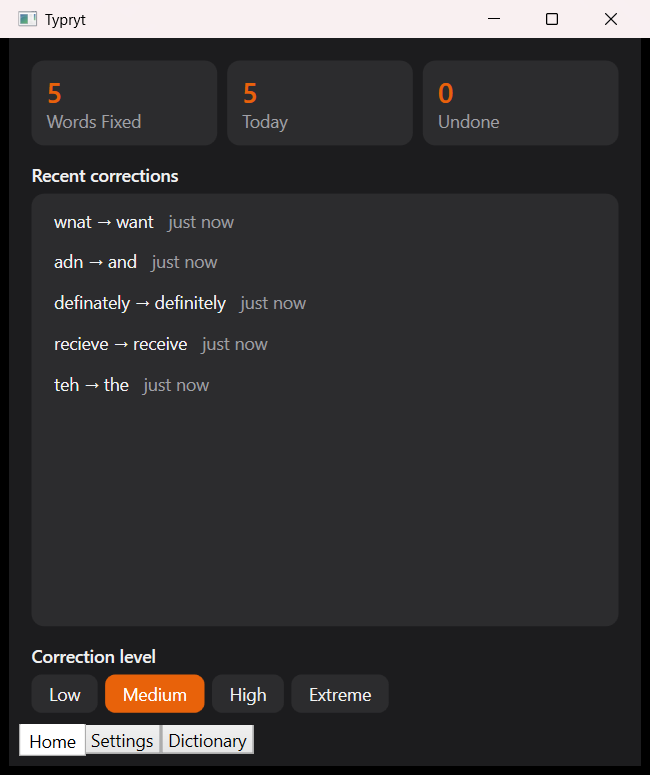
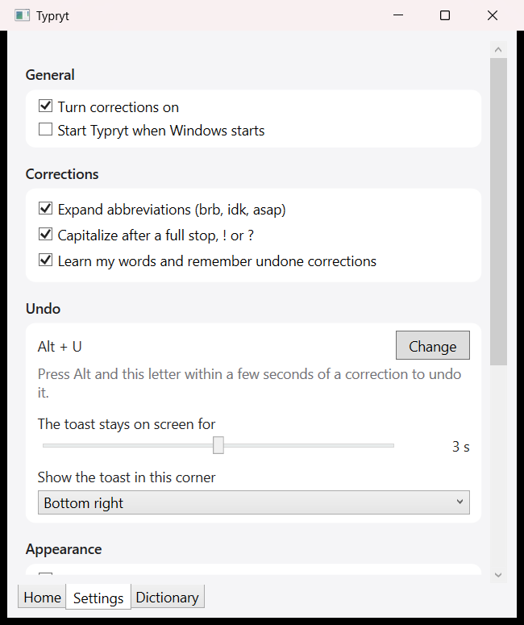

# Typryt

**Type it right.**

Typryt works like mobile autocorrect, but for Windows 11 desktop. It listens to what you type in the apps you allow, corrects typos when you press Space, and lets you undo any correction with a single key press.




## Features

- **Corrects as you type:** typos, slang (`lyk` → `like`), apostrophes (`dont` → `don't`), and abbreviations (`brb` → `be right back`).
- **Undo any correction:** a toast shows what changed, with an Undo button. Press **Alt + U** (or your own letter) within 3 seconds to undo. Undone words are not corrected again.
- **Learns your words:** words you type often and no dictionary knows are added to your personal dictionary. You can add, search, and remove words in the Dictionary tab.
- **Correction levels:** Low, Medium, High, or Extreme, from rules only to aggressive suggestions.
- **Works where you allow it:** on first launch you choose the apps where corrections run. Browsers and Notepad are on by default.
- **Home tab:** words fixed, today's count, undone count, and the last 50 corrections.
- **Settings:** master on and off switch, abbreviations, auto-capitalize, learning, undo key, toast duration and corner, dark or light theme, and start with Windows.
- **Tray icon:** runs quietly in the notification area. Right-click for on and off, the dashboard, correction history, and Exit.
- **Private:** everything runs on your PC. Nothing is sent over the internet. Your settings, learned words, and history are stored in `%APPDATA%\Typryt`.

## Requirements

- Windows 11 (64-bit).
- To build from source: .NET 10 SDK, Python 3.12, and Inno Setup 6 (only for the installer).

## Install

Run `TyprytSetup-1.0.0.exe` (built with the steps below). It installs for your user account only, so no administrator password is needed. Typryt starts with a short splash animation and then sits in the tray.

## Build from source

1. **Engine (Python):**

   ```bash
   cd python-engine
   py -3.12 -m venv venv
   venv\Scripts\python.exe -m pip install -r requirements.txt
   ```

2. **App (.NET):**

   ```bash
   cd csharp-app
   dotnet build Typryt.csproj
   ```

3. **Run from the project:** start the engine from `python-engine` with `venv\Scripts\python.exe -m uvicorn main:app --host 127.0.0.1 --port 8000`, then run `csharp-app\bin\Debug\net10.0-windows\Typryt.exe`. The app also starts the engine by itself when it finds the venv.

4. **Release build and installer:**

   ```bash
   python-engine\build_engine.ps1
   ```

   ```bash
   dotnet publish csharp-app\Typryt.csproj -c Release -r win-x64 --self-contained true -p:PublishSingleFile=false -o publish\app
   ```

   Copy `python-engine\dist\typryt-engine` into `publish\app\engine`, then compile `installer\setup.iss` with Inno Setup 6.

## How it works

- **Keyboard hook:** a global low-level hook watches keys in every app and passes each finished word to the engine.
- **Engine:** a local FastAPI server on `127.0.0.1:8000`. It corrects words with slang, apostrophe, and abbreviation rules, then symspellpy and Hunspell (via spylls).
- **Replacement:** the corrected word is pasted over the typed one, and the clipboard is restored afterwards.

## Tech stack

- **App:** C#, .NET 10, WPF, Windows Forms (tray icon only), Win32 keyboard hook.
- **Engine:** Python 3.12, FastAPI, Uvicorn, symspellpy, spylls (Hunspell dictionary reader), PyInstaller for the packaged build.
- **Installer:** Inno Setup 6.

## Project layout

- `csharp-app\`: the Windows app (WPF).
- `python-engine\`: the correction engine (FastAPI).
- `shared\`: your local settings and data when running from the project (git-ignored).
- `installer\`: the Inno Setup script.
- `docs\screenshots\`: images used in this README.

## Known limits in 1.0

- Corrections run only in apps you allow. Apps that do not accept pasted text may not be corrected.
- Words you undo are not corrected again until you remove them in the Dictionary tab.
- The context-aware spelling layer (jamspell) is not included in 1.0. Corrections use the rules, symspellpy, and Hunspell.
- If the app is ended from Task Manager, the engine it started may keep running. The next start reuses it.

## License

Source available. The code is publicly viewable. No redistribution, resale, or repackaging without explicit written permission from Gokul P. See [LICENSE.txt](LICENSE.txt).
