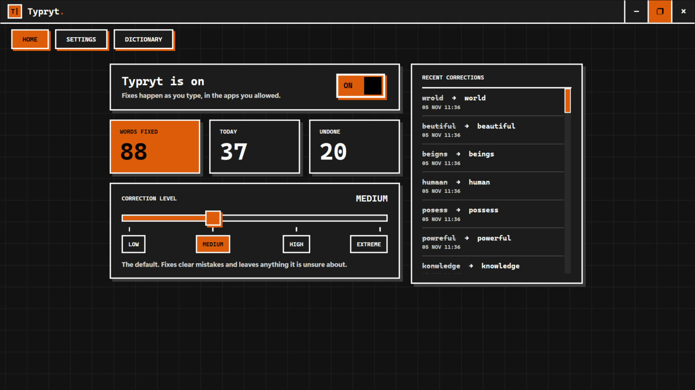
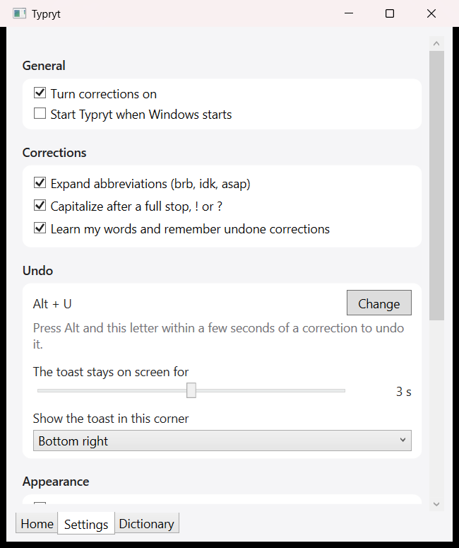

# Typryt

**Type it right.**

Typryt is autocorrect for the Windows 11 desktop, in the style of a phone keyboard. It runs in the notification area, watches what you type in the apps you allow, fixes typos as you finish each word, and lets you undo a correction with one key press. Everything runs on your own PC.

Version 1.0.2 (release candidate). Licensed under the PolyForm Strict License 1.0.0 (see `LICENSE.txt`): you may use it for any noncommercial purpose, but not redistribute or change it.




## What it does

- **Corrects a word when you finish it.** The word is corrected when you press **Space**, **Enter**, **Tab**, or one of `, ! ? ; : ) ] "`. A period at the very end of your text corrects the word before it after a short pause (about 0.6 seconds). Only the word is changed; the key you pressed is then delivered unchanged, so no key is lost, doubled or reordered.
- **Typos, slang, apostrophes, abbreviations.** `teh` becomes `the`, `lyk` becomes `like`, `dont` becomes `don't`, `brb` becomes `be right back` (abbreviations can be switched off). Stretched words (`soooo`, `thankss`), days and months, a lone `i`, and a capital letter after a full stop, `!` or `?` are handled too. The first word of a text box is never capitalized, because Typryt cannot tell where a text box starts.
- **Commas and spacing.** A comma is added after trigger words such as "however", double spaces and spaces before punctuation are fixed, `...` becomes an ellipsis, and doubled punctuation is collapsed.
- **Leaves alone what it should.** Names, places, brands, technical words, ALL-CAPS words, numbers, words with digits, URLs, email addresses, file paths, code (identifiers with `_`, brackets attached to a word) and anything it does not recognise with strong evidence stay exactly as typed.
- **Undo.** After a correction a small message shows what changed, with an **Undo** button. Press **Alt + U** (or the letter you choose) within 3 seconds, while the cursor is still directly after the corrected text, to restore exactly what you typed. This also works for comma insertions and for spacing and punctuation fixes. Undo applies to that one correction only: it does not block the word, and the word can be corrected again the next time. Undo is not offered after a correction made by Enter or Tab (the cursor has moved on).
- **Learns your words.** A word that no dictionary knows, that Typryt left unchanged, and that you type three times is added to your personal dictionary and is never changed again (at any correction level). A word Typryt corrects is never learned, so a typo you keep making stays a typo. Learning can be switched off. You can add, search and remove words in the Dictionary tab.
- **Correction levels.** Low (only exact rules: slang, abbreviations, apostrophes, curated misspellings), Medium (the default: also confident dictionary fixes), High (also single-key slips such as swapped letters), Extreme (also looser guesses; expect mistakes). Each level changes everything the level below it changes.
- **Works where you allow it.** On first launch you choose the apps. Browsers (Chrome, Edge), Notepad and Word are on by default; you can turn any app off in Settings, and the change applies at once.
- **Never in password fields.** Nothing typed into a password field, or into a control Typryt cannot identify, is sent to the correction engine.
- **Safety net.** If something goes wrong that could cost keystrokes (a keyboard-hook fault, corrections repeatedly running late, the engine stopping for good), Typryt delivers every key it was holding, pauses itself, says so in the tray tooltip and in one message, and stays paused until you turn it on again from the tray menu or the master switch.

## Install

1. Download `Typryt-Setup-1.0.2.exe` and its `.sha256` file from the release page, and check the hash (`Get-FileHash Typryt-Setup-1.0.2.exe`).
2. Run it. It installs for your user account only (`%LOCALAPPDATA%\Programs\Typryt`): no administrator password is needed. If Typryt is already running, the installer closes it first. Upgrading from an earlier version keeps your settings and dictionary.
3. Windows may show **"Windows protected your PC"** (SmartScreen), because the installer is not code-signed. Choose *More info*, then *Run anyway*, if you trust the download.
4. Typryt shows a short splash, then sits in the notification area (the **T|** icon). Right-click it for On/Off, the dashboard, correction history and Exit. Running the program a second time opens the dashboard.

Uninstall from *Settings > Apps*. The uninstaller asks whether to also delete your settings and personal dictionary (the default is No; a silent uninstall always keeps them).

## Use

Just type. When a correction is made, a message appears for a few seconds; press **Alt + U** to undo it. The **Home** tab shows Words Fixed, today's count, Undone, the correction level and the last 50 corrections. **Settings** has: the master switch, start with Windows, abbreviations, capitalization, learning, the undo letter, how long the message stays, which corner it appears in, light/dark theme, and the list of allowed apps. Every setting takes effect at once and is kept after a restart.

## Privacy

- **Everything stays on your PC.** Typryt never uses the network except to talk to its own correction engine on `127.0.0.1` (this PC only).
- **The engine is private to your session.** At every start Typryt picks a free port and a random token, starts the engine with them, and the engine refuses every request that does not carry the token. It listens on `127.0.0.1` only.
- **What is stored, and where** (`%APPDATA%\Typryt`):
  - `config.json`: your settings and the list of allowed apps.
  - `stats.json`: counters and the **last 50 corrections** (the original and corrected word), shown on the Home tab.
  - `personal_dict.json`: words you added or Typryt learned (readable, so the Dictionary tab can show them) and typing counts of unknown words kept only as salted hashes.
  - `logs\`: daily logs of timings, lengths and outcomes. **Typed words are not written to the logs.** Logs older than 7 days are deleted.
- Nothing typed in a password field reaches the engine.

## Known limitations

- **Unsigned installer.** Windows SmartScreen warns about it; some antivirus tools may flag any program that installs a keyboard hook (Typryt needs one to see your typing).
- **Browsers and the text they hold.** Typryt cannot read the text in Chrome or Edge, so it corrects from the keys it saw. After you move the cursor (arrow keys, Home, End, a click), paste, undo in the app, or press Backspace past the start of the word you are typing, the next word is left as typed rather than risk editing the wrong text. In Notepad and Word, where the text can be read, the word before the cursor is found from the real text.
- **Notepad is slower** than browsers: a correction there takes roughly a fifth of a second, and Typryt types the correction with short pauses so Notepad does not drop keys.
- **Word** is on the default list but was **not tested**: Word's first-run privacy dialog could not be accepted by the test run, and Word's own AutoCorrect can also change the same word.
- **Firefox, WordPad and input methods (IME).** Not tested. Typryt does not hold keys while an input method is composing or a dead key is pending.
- **Spelling accuracy depends on a time-limited dictionary lookup.** The first time you type a misspelling the dictionary lookup may not finish in time and the word is left as typed; the same misspelling is usually fixed the next time.
- **Only English** (US dictionary; British spellings such as *neighbour* are accepted as valid and left alone).

## Measured on this release candidate

Measured on the installed 1.0.2 build with the test input switch on (needed so the test tools' keys are seen), Windows 11 build 26300, one monitor at 125 %. Details and the failures are in the release test report (not part of the repository).

- **Accuracy (Medium, frozen sets, run once):** held-out set: 3 of 205 valid words changed (1.5 %), 3 of 172 wrong replacements (1.7 %), 127 of 172 correct fixes (73.8 %). Sentence set (150 sentences, typed word by word through the engine): 126 exact (84 %), 0.8 % of valid words changed, 4.0 % wrong. The engine's dictionary lookup is time-limited, so the first sight of a misspelling is sometimes missed; the numbers move by a point or two between cold runs.
- **Correction levels:** on the held-out set Low changes 69 words, Medium 131, High 134, Extreme 196, each a superset of the one before.
- **Speed:** the engine answers in a median of 5 ms (p95 7 ms); a delimiter is held a median of 6 ms (p95 16 ms) and at most about 200 ms in a 60-minute test; a correction in Notepad takes about 0.2 s.
- **Keys:** Chrome, "recieve now" typed at 20 ms and at 60 ms per key: 30 of 30 correct each; Notepad "lyk NOW Bye": 30 of 30 each; engine stalled or killed in the middle of a held key: 30 of 30 each; a 5,000-key test lost nothing (the one missing character was a double space the program collapses on purpose).
- **Soak (60 minutes of typing in Chrome):** no crash, no logged error, no engine restart; the app grew from 54 to 61 MB private memory (+11.8 %); the engine stayed at 236 MB.
- **Known problem:** in real-text tests (10 passages, 80-150 words each, typed with bursts, pauses and Backspace corrections) 13 of 16 runs matched what the engine's own answers predicted exactly; in the others a block of typed text was missing. The cause was not found; some of these coincide with test-tool activity on the same PC, but that is not proven.

## Build from source

Requirements: Windows 11 x64, .NET 10 SDK, Python 3.12, Inno Setup 6.

```
cd python-engine
py -3.12 -m venv venv
venv\Scripts\python.exe -m pip install -r requirements.txt
```

Run from the project: `dotnet build csharp-app\Typryt.csproj`, then `csharp-app\bin\Debug\net10.0-windows\Typryt.exe`. The app starts the engine from the venv by itself.

Release build and installer, in one repeatable run:

```
powershell -ExecutionPolicy Bypass -File installer\build_release.ps1
```

It builds the engine with PyInstaller and checks that every data file is inside it, runs the built engine and checks its answers, publishes the app (self-contained, win-x64), copies the engine in, compiles `installer\setup.iss` with Inno Setup (`%LOCALAPPDATA%\Programs\Inno Setup 6\ISCC.exe`, or pass `-Inno`), and writes `installer\Output\Typryt-Setup-<version>.exe` with a `.sha256` file next to it.

## How a word is checked

In this order: a lone `i`; laughter (`lol`, `haha`: never expanded); abbreviations (when on); slang; apostrophes; days and months; the curated misspelling map; stretched letters; then words that are known (the project lexicons of tech terms, names, places and brands; the word-frequency list; the Hunspell `en_US` dictionary, read through the pure-Python `spylls` package) are left alone. An unknown word is changed only on strong evidence (one edit away, a frequent target word, a typical typing slip or the dictionary's own first suggestion). Weaker guesses get a lower confidence and are applied only at the High and Extreme levels. Capitalization after a sentence end is applied last. Typryt does not use jamspell or any online service.

## Credits and licences

Third-party components and their licences are listed in `THIRD_PARTY_NOTICES.md`.
